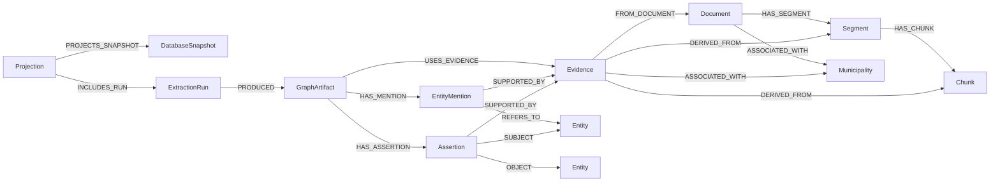

# Canonical Neo4j projection

Status: **implemented** for verified graph-extraction artifacts. Bounded
canonical graph retrieval and deterministic citation rendering are implemented
against this model. Community detection, vector projection into Neo4j, and
Text2Cypher are **unsupported**.

## Authority and scope

SQLite is the authoritative evidence and extraction store. Neo4j is a
reproducible, disposable read projection of an audited SQLite snapshot; a
Neo4j database is never treated as evidence or as the sole record that a
projection completed.

Every invocation requires a validated content-addressed SQLite snapshot
manifest, explicit canonical extraction run IDs, explicit Neo4j endpoint,
database and write principal, an environment variable containing the password,
and an explicit local SQLite projection-ledger path.

Only `verified` `graph_triplets` with an `inserted` outcome from a `completed`
or `completed_with_errors` run enter the projection. Legacy-unclassified and
spaCy demo artifacts are excluded. A selected run must either identify the
manifest itself or record the live database identity from which the manifested
snapshot was created. Chunk-to-segment-to-document consistency and immutable
evidence joins are validated before the first Neo4j write.

## Graph model

All projected nodes carry `projection_id` and `snapshot_id`. Each label has a
unique `projection_key`, derived from `projection_id`, object kind and the
stable application ID.



`Assertion` is an explicit node rather than a relationship collapsed between
two entities. Multiple extracted claims between the same entity pair remain
independently addressable by assertion ID, extraction run, source and evidence.
`EntityMention` likewise preserves every observed occurrence.

Neo4j `Evidence` stores identity and reconstruction metadata only:
`evidence_id`, source type/ID, segment/chunk/document IDs, source URL, content
hash and snapshot scope. Run, model and prompt are retained on artifacts and
assertions. Immutable evidence text remains in SQLite. A relationship-specific
excerpt may be projected on `Assertion` for usability and is marked as a
derived cache; `--omit-evidence-excerpts` disables it.

Many-to-many municipality associations come from
`evidence_municipalities`; projection never reduces a document to the legacy
single-municipality column.

## Stable identities

The deterministic `projection_id` binds the projection schema version,
snapshot manifest identity, sorted extraction run IDs and credential-free
Neo4j target identity. Artifact, mention and assertion IDs bind their stable
run/source identity and ordinal content. Evidence uses the approved immutable
`evidence_id`. Entity IDs use canonicalized name, type and category. SQLite
`rowid` is never loaded or exported.

The target password is neither fingerprinted nor persisted. URI userinfo,
query parameters and fragments are rejected. Error summaries are bounded and
sanitized by the extraction lifecycle's safe-error contract.

## Idempotence and reconciliation

Every write uses `MERGE` on immutable `projection_key` values and `ON CREATE`
for historical properties. A repeated completed projection deliberately
replays all batches and verifies exact per-label namespace counts. It cannot
increment weights, duplicate assertions or mutate historical evidence.

Changed run selection, snapshot or target creates a different projection
namespace. Namespaces coexist explicitly and are never silently combined. No
broad delete or graph wipe is part of projection; stale namespaces remain
inspectable until a separately authorized retention operation exists.

Each batch is one bounded Neo4j transaction. The local ledger records intended
scope, configuration fingerprint, expected counts, target identity, batch
fingerprints, attempts and lifecycle status. A failed transaction marks the
projection failed. Resume replays failed/running batches and skips locally
completed batches. If Neo4j committed but local bookkeeping was interrupted,
replay remains safe because graph writes are idempotent.

If exact namespace reconciliation fails after all batches were recorded, every
batch is invalidated for replay. This repairs missing remote state on retry;
unexpected extra state remains failed for explicit investigation because
normal reconciliation never performs a destructive graph wipe.

Completion is recorded only after all batches complete and Neo4j per-label
counts exactly match the plan. The server's Neo4j database ID is required and
recorded; it supplements rather than replaces explicit target identity.

## Usage

```bash
python -m crawler.scripts.create_database_snapshot \
  --db crawler/data/db/crawl.sqlite \
  --output snapshots/crawl-2026-08-13.sqlite

export GRAPHRAG_NEO4J_PROJECTION_PASSWORD='replace-with-a-secret'
python -m crawler.scripts.project_graph_to_neo4j \
  --snapshot-manifest snapshots/crawl-2026-08-13.sqlite.manifest.json \
  --run-id 86fbd324-example-run-id \
  --ledger generated/projections/neo4j-ledger.sqlite \
  --neo4j-uri neo4j+s://graph.example.test:7687 \
  --neo4j-database neo4j \
  --neo4j-user graphrag_projection_writer \
  --neo4j-password-env GRAPHRAG_NEO4J_PROJECTION_PASSWORD
```

`crawler.scripts.export_graph_to_neo4j` is a deprecated CLI alias that delegates
to this command. Its former Python API fails closed because a rowid-oriented
call cannot express the required snapshot/run scope. The incompatible legacy
community writer has also been removed; `detect_communities` fails closed until
a projection-bound community-report lifecycle exists.

## Security assumptions and limitations

The principal is a write identity used only by projection. Canonical retrieval
uses a separate explicitly confirmed read-only principal. Neo4j Community
Edition cannot provide every enterprise authorization guarantee, so this code
does not claim database-enforced read-only security for future readers.
Text2Cypher remains disabled and outside this projection contract.

TLS behavior is explicit in the URI scheme. The implementation does not
disable certificate verification: `neo4j+s`/`bolt+s` use verified TLS, while
`+ssc` explicitly requests self-signed-certificate trust. Endpoint, database
and credentials have no projection defaults.

Full evidence text, document links, embeddings, and community reports are not
projected. Retrieval resolves projected identities back to authoritative
SQLite. The legacy query-agent Python path is disabled.

## Validation

Fixture tests cover scope validation, stable IDs, segment and chunk paths,
multi-municipality documents, multiple assertions per entity pair, evidence
reuse, distinct runs, snapshot mismatch, idempotent repeat, namespace
coexistence, partial failure, resume and constraints.

An opt-in disposable Neo4j 5 Community harness lives in
`tests/integration/docker-compose.neo4j.yml`. It accepts only loopback test
endpoints and uses tmpfs. See `tests/integration/README.md`.
