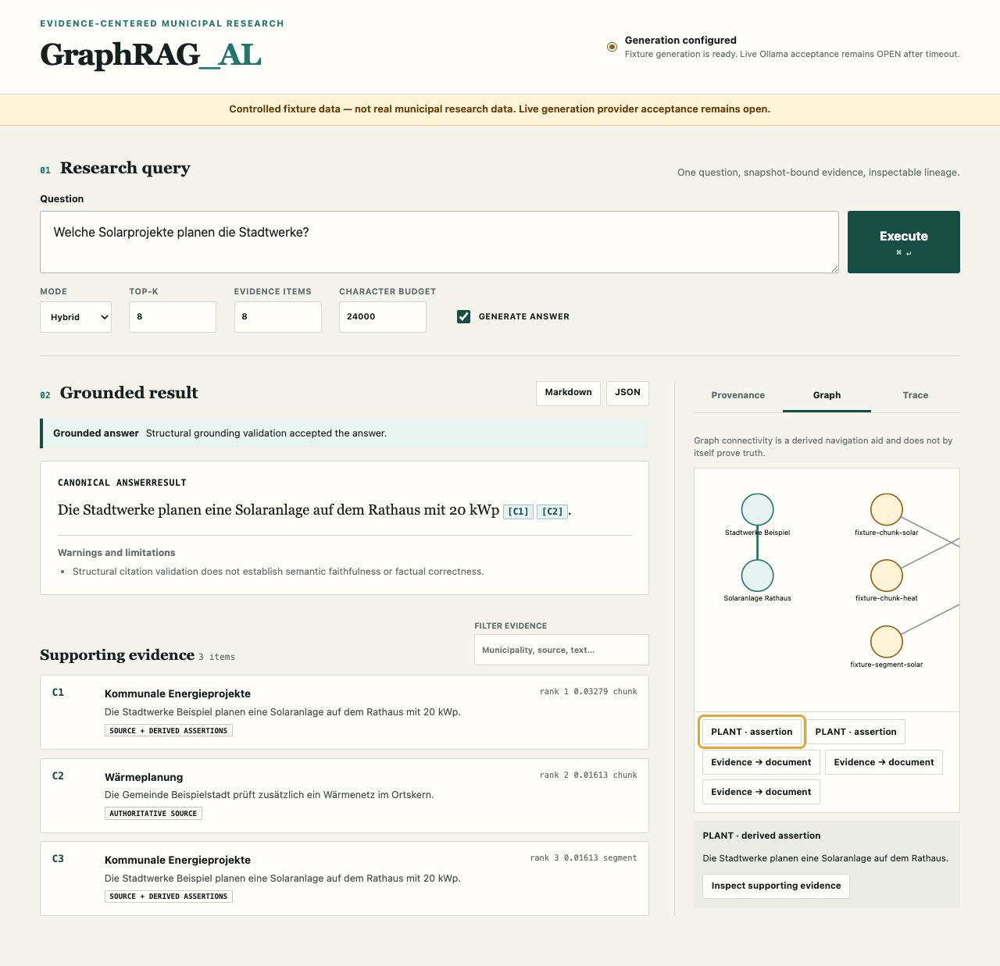

# Interactive research application

Status: **implemented** for local, snapshot-bound semantic, graph, and hybrid
research workflows. Live Ollama acceptance remains **OPEN** because the available
model timed out during the separate provider gate. Fixture generation is not
evidence that live provider acceptance has passed.

## Architecture boundary

The application is intentionally a consumer of canonical backend contracts:

```text
Browser presentation (HTML/CSS/JavaScript)
  -> FastAPI HTTP boundary
  -> ResearchApplicationService
  -> CanonicalRetriever / CanonicalAnswerGenerator
  -> immutable RetrievalResult / AnswerResult
```

The browser contains no retrieval, ranking, grounding, provider, SQL, Cypher,
citation-identity, or provenance-reconstruction logic. `ResearchApplicationService`
constructs typed requests and projects canonical results for inspection without
mutating them. Exports call the canonical Markdown and JSON renderers. A session
store retains the complete immutable result object associated with each export ID.

FastAPI was selected because the repository is Python-native and needs typed,
testable HTTP boundaries and safe exception handling. Server-rendered static HTML,
CSS, and small dependency-free JavaScript avoid a separate Node build system.

## Controlled fixture mode

Create a Python 3.11 environment, install the declared development dependencies,
and start the local fixture:

```bash
python3.11 -m venv .venv
.venv/bin/python -m pip install -r requirements-dev.txt
.venv/bin/python -m crawler.web --fixture --host 127.0.0.1 --port 8000
```

Open `http://127.0.0.1:8000`. Fixture mode generates its own disposable source
database, canonical embedding artifact, manifested snapshot, graph projection
plan, and answer-run log in an isolated temporary directory. It never reads
`crawler/data/db/crawl.sqlite`. The banner marks every fixture result as controlled
test data rather than real municipal research data.

The fixture exercises:

```text
generated SQLite source
  -> manifested snapshot
  -> CanonicalRetriever (semantic / graph / hybrid)
  -> CanonicalAnswerGenerator
  -> deterministic fixture provider
  -> AnswerResult
  -> application adapter and browser
```

## Configured snapshot mode

The application fails closed unless the database is the exact SQLite file bound
by the manifest. The answer-run log parent directory must already exist.

```bash
mkdir -p generated/answer-runs
export KLIMA_UI_SNAPSHOT_MANIFEST=/absolute/path/snapshot.sqlite.manifest.json
export KLIMA_UI_DB_PATH=/absolute/path/snapshot.sqlite
export KLIMA_UI_ANSWER_RUN_LOG=$PWD/generated/answer-runs/ui.jsonl
.venv/bin/python -m crawler.web --host 127.0.0.1 --port 8000
```

Semantic retrieval also uses the embedding settings whose defaults match the
canonical embedding CLI. The installed local model must match the snapshot's
embedding lineage. Model downloads are not performed by the UI.

Graph and hybrid retrieval additionally require an exact projection and a
dedicated read-only Neo4j principal:

```bash
export KLIMA_UI_NEO4J_ENABLED=1
export KLIMA_UI_PROJECTION_ID=neo4j-projection-sha256:...
export KLIMA_UI_EXTRACTION_RUN_IDS=run-id-1,run-id-2
export KLIMA_RETRIEVAL_NEO4J_READONLY_CONFIRMED=1
export KLIMA_RETRIEVAL_NEO4J_URI=bolt://127.0.0.1:7687
export KLIMA_RETRIEVAL_NEO4J_DATABASE=neo4j
export KLIMA_RETRIEVAL_NEO4J_USER=graphrag_retrieval_reader
export KLIMA_RETRIEVAL_NEO4J_PASSWORD='set-outside-shell-history'
```

The UI never displays the password, raw connection string, or a backend stack
trace. Neo4j connectivity is not needed for semantic retrieval.

## Answer generation and provider readiness

Retrieval-only use is the default configured state. To configure Ollama answer
generation explicitly:

```bash
export KLIMA_UI_GENERATION_ENABLED=1
export KLIMA_OLLAMA_URL=http://127.0.0.1:11434
export KLIMA_OLLAMA_MODEL=llama3.1:8b
```

This marks the provider as configured, not accepted. The research UI continues
to display `open_live_provider_timeout` until a separate live-provider acceptance
run closes that gate. A timeout or unavailable provider yields a typed canonical
generation-failure result while retrieved evidence remains inspectable. The UI
does not attempt fallback providers.

## Research workflow

1. Enter a question and choose semantic, graph, or hybrid retrieval.
2. Set canonical top-k and answer-context item/character budgets.
3. Disable answer generation for retrieval-only investigation when desired.
4. Inspect answer status, grounding status, inline citation links, ranked evidence,
   source/document hierarchy, municipality context, and canonical source URLs.
5. Open the Graph tab to inspect stable entity/assertion/evidence/document identity.
   Connectivity is explicitly described as a derived navigation aid, not factual proof.
6. Open Trace for semantic, graph, and reciprocal-rank-fusion contributions, final
   rank, deduplication identity, snapshot, projection, and run scope.
7. Export the immutable current result through canonical Markdown or JSON renderers.

The evidence detail dialog distinguishes authoritative source evidence from derived
graph assertions. Canonical URLs are linked only when supplied by the result.
Closing the dialog returns to the same result and query state.

## Accessibility and interaction

Controls have visible labels, semantic roles, keyboard focus indicators, status
announcements, and non-color status text. `Command/Ctrl+Enter` executes a query.
Tabs, citations, evidence cards, graph nodes, and graph edges are keyboard usable.
The layout reflows for narrow screens and honors reduced-motion preferences.

## Error and empty states

The application explicitly represents no query, no evidence, insufficient
evidence, provider unavailable, provider timeout, generation failure, grounding
failure, snapshot mismatch, Neo4j unavailable, malformed configuration, and safe
backend failure. Rejected provider text is never styled as a grounded answer.

## Validation and limitations

Focused tests use the real canonical fixture path. The existing live Neo4j suite
remains the disposable-service integration gate. The UI supports local single-process
research sessions; its immutable in-memory export store is not a multi-user history
service. Municipality/source filtering currently filters the returned evidence for
inspection and does not alter canonical retrieval semantics. Global/community
retrieval, semantic-faithfulness guarantees, and production readiness remain
**unsupported**.


