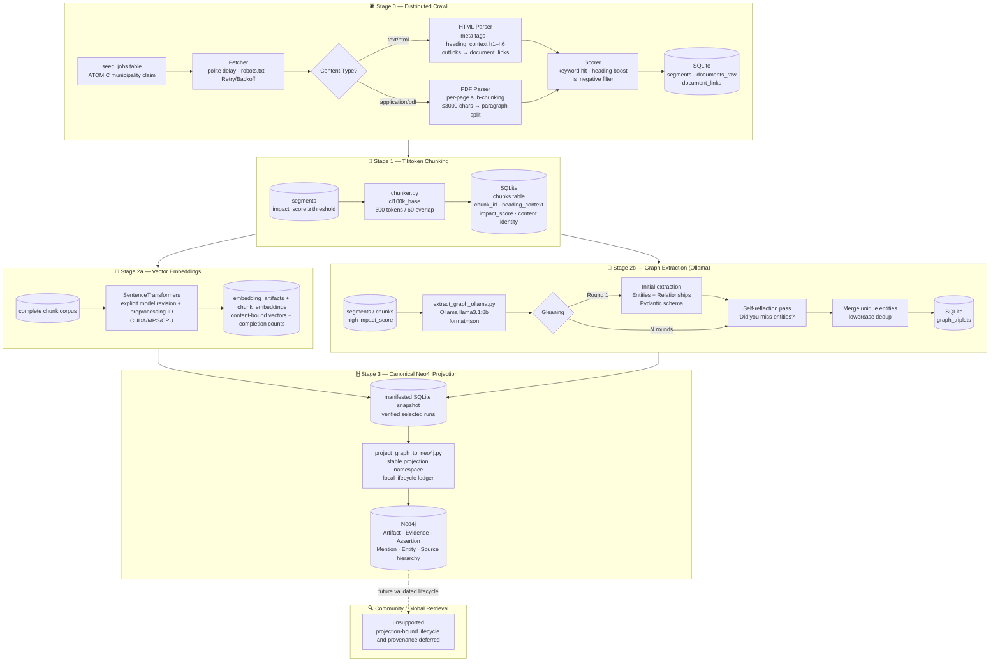
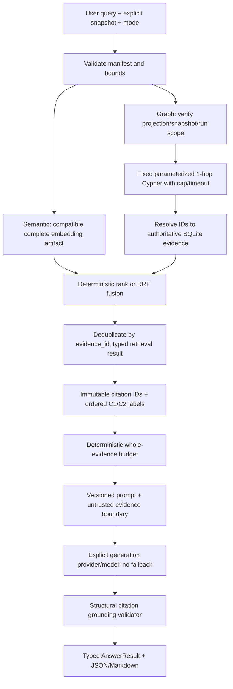
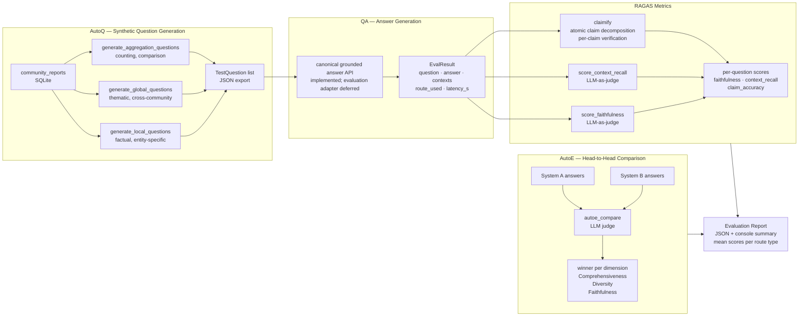
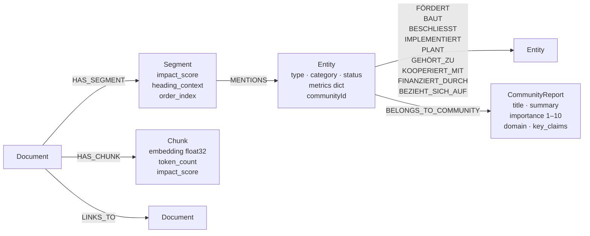

# KIT KlimaCrawler — GraphRAG Pipeline Diagrams

Visual overview of the full index-time and query-time flows.

---

## 1. Index-Time Pipeline (Data Ingestion → Graph Construction)



---

## 2. Query-Time Pipeline (Canonical Retrieval and Answer Generation)



---

## 3. Evaluation Pipeline (Stage 5)



---

## 4. Legacy downstream Neo4j schema (not compatible with canonical projection)

The following diagram describes the pre-projection community/query modules.
They are not enabled for the canonical model. See
[`NEO4J_PROJECTION.md`](NEO4J_PROJECTION.md) for the implemented schema.



---

## 5. Running the Full Pipeline

```bash
# 0. Crawl municipalities (distributed)
python -m crawler.scripts.init_seed_jobs
python -m crawler.scripts.run_worker

# 1. Tiktoken chunking
python -m crawler.scripts.chunk_documents --chunk-size 600 --overlap 60 --min-score 15

# 2a. Generate embeddings (local GPU)
python -m crawler.scripts.generate_embeddings --model paraphrase-multilingual-MiniLM-L12-v2

# 2b. Extract entity graph (Ollama, privacy-compliant)
python -m crawler.scripts.extract_graph_ollama --model llama3.1:8b --gleaning 1 --chunk-mode

# 2c. Create a snapshot, then project selected completed extraction run IDs.
python -m crawler.scripts.create_database_snapshot --db crawler/data/db/crawl.sqlite \
  --output snapshots/crawl.sqlite
# See docs/NEO4J_PROJECTION.md for the explicit projection command.

# Community detection and query are not yet migrated to the canonical graph.

# 5. Scientific evaluation
python -m crawler.scripts.evaluate --questions 30 --output eval_results.json

# Utilities
python -m crawler.scripts.resolve_entities          # Entity deduplication
python -m crawler.scripts.summarize_documents       # Per-document LLM summaries
python -m crawler.scripts.analyze_topics            # BERTopic topic modelling
```
